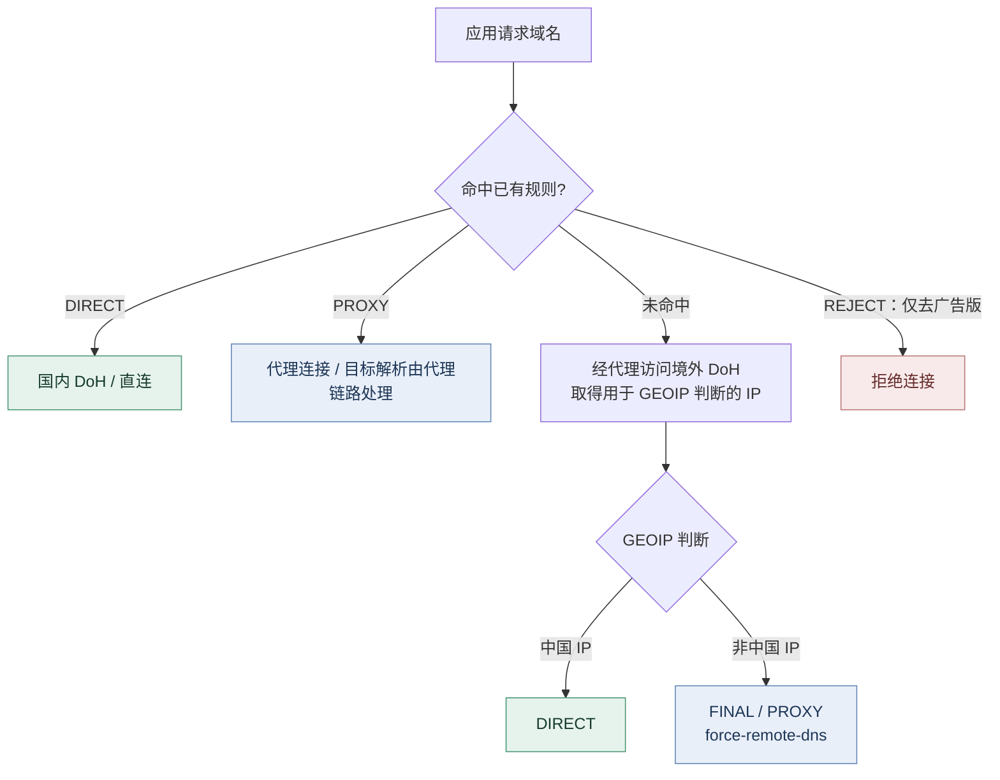
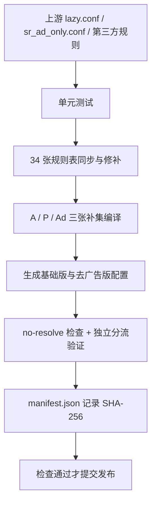

<h1 align="center">Shadowrocket 懒人配置 · DNS 国内外分流</h1>

<p align="center">DNS 分流与防泄漏方案：基于原版懒人配置，调整 DNS 路径，补充直连与代理规则；提供基础版、去广告版，每日自动构建。</p>

<p align="center">
  <a href="https://github.com/johnnyliat/shadowrocket-lazy-dns-split/actions/workflows/sync.yml"></a>
  <a href="https://github.com/johnnyliat/shadowrocket-lazy-dns-split/actions/workflows/health.yml"></a>
</p>

基于懒人配置优化的 DNS 分流与防泄漏方案：**国内域名用国内 DoH 直连，国外域名走代理远端解析；未知域名经代理 DoH 预解析，由 GEOIP 判断直连或代理。** 整合多源规则，去重补全直连与代理策略；广告拦截可选；GitHub Actions 每日自动构建、校验和更新。

## 分流与 DNS 路径



> 图中表示规则决策路径，不代表已证实未知域名在 GEOIP 判断后一定会重新进行一次国内或 VPS DNS 查询。DNS 回退、连接建立和远端解析的具体行为还受 Shadowrocket、节点协议及服务端配置影响。

## 选择版本

| 版本 | 内容 | 订阅地址 |
|---|---|---|
| **基础版** | 原版懒人配置 + DNS 分流补丁 + 直连/代理补集 | [lazy-dns.conf](https://raw.githubusercontent.com/johnnyliat/shadowrocket-lazy-dns-split/main/lazy-dns.conf) |
| **去广告版** | 基础分流 + 内嵌广告 REJECT 规则 | [lazy-dns-ad.conf](https://raw.githubusercontent.com/johnnyliat/shadowrocket-lazy-dns-split/main/lazy-dns-ad.conf) |

| 基础版 | 去广告版 |
|:---:|:---:|
|  |  |

基础版订阅地址：

```text
https://raw.githubusercontent.com/johnnyliat/shadowrocket-lazy-dns-split/main/lazy-dns.conf
```

去广告版订阅地址：

```text
https://raw.githubusercontent.com/johnnyliat/shadowrocket-lazy-dns-split/main/lazy-dns-ad.conf
```

两个版本使用同一套 DNS 与分流机制。去广告版在靠前位置加入广告拦截规则，命中后优先 `REJECT`，实际访问结果与基础版不一定完全相同。广告规则来自上游 `sr_ad_only.conf` 和补充规则集，无需启用 HTTPS 解密。

### 使用

要求 **Shadowrocket 2.2.92 或更新版本**；旧版本可能不支持此配置依赖的 `direct-dns-server`。

1. 添加可用代理节点或节点订阅。
2. 扫描二维码，或将对应地址作为配置 URL 导入 Shadowrocket。
3. 选中导入的配置；首页「全局路由」选择「配置」。
4. 开启连接，确认节点可用。
5. 按需开启配置自动更新。

本仓库只提供客户端配置，不提供代理节点，也不修改 3x-ui / Xray 服务器设置。

## DNS 泄漏检测

启用本配置后，分别运行下面三个测试，结合 Shadowrocket 日志核对出口 IP 与 DNS 解析器。建议在 Wi-Fi、蜂窝网络及节点切换后各测一次。原理：页面用没人访问过的随机子域名，手机必须现场查询它的 IP，网站借此记下真正执行查询的 DNS 服务器。

| 网站 | 网址 | 说明 |
| --- | --- | --- |
| [BrowserLeaks](https://browserleaks.com/dns) | https://browserleaks.com/dns | 信息最全，列出 DNS 服务器的地址、运营商和国家 |
| [ipleak.net](https://ipleak.net) | https://ipleak.net | 同页显示出口 IP 与 DNS 服务器，方便对照出口与解析器 |
| [DNS Leak Test](https://www.dnsleaktest.com) | https://www.dnsleaktest.com | 选 Extended test，探针更多，查得更细 |

**通过标准**：三个站列出的 DNS 服务器应全部属于 Cloudflare 或 Google（配置里写明的解析商），不应出现阿里、腾讯和本地运营商。Cloudflare/Google 回答节点的注册地可能不在出口 IP 所在的国家（如加拿大），属正常——看服务商，不看国家。三个站结果一致，说明浏览器里这路查询没有泄露；但这只能证明测试查询走了预期路径，不能证明每个代理目标都由 VPS 解析。

三个检测站只能观察各自发起的查询；无法穷尽 App 自带 DoH、系统服务、故障回退及所有节点协议的行为。要查明具体路径，需要结合客户端日志、网络抓包与 VPS 侧记录。

## 为什么要改 DNS

代理连接走了 VPS，不代表分流前的域名查询也走了 VPS：未命中域名规则的请求要靠 `GEOIP` 等 IP 规则判定，判定前须先解析域名；这一步若用本地 DNS，即使最后走代理，查询也已发给本地解析器。

本仓库保留原版规则覆盖，重点调整三种路径：

| 请求 | 分流方式 | DNS 设计 |
|---|---|---|
| 命中 DIRECT | 直接连接 | 使用国内加密 DNS (`direct-dns-server`) |
| 命中 PROXY | 代理连接 | 尽量避免为分流在本地预解析；目标解析还取决于代理协议及服务端 |
| 未命中明确规则 | 经代理 DoH 取得 IP，交给 GEOIP 判断 | 中国 IP 直连；非中国 IP 进入 FINAL 代理 |

关键配置如下（以仓库自动生成的成品为准）：

```ini
dns-server = https://cloudflare-dns.com/dns-query#proxy,https://dns.google/dns-query#proxy
direct-dns-server = https://dns.alidns.com/dns-query,https://doh.pub/dns-query
proxy-dns-server = https://dns.alidns.com/dns-query,https://doh.pub/dns-query
fallback-dns-server = https://dns.alidns.com/dns-query,https://doh.pub/dns-query
dns-fallback-system = false
dns-direct-system = false
dns-direct-fallback-proxy = true
allow-dns-all = false
ipv6 = false
private-ip-answer = true

GEOIP,CN,DIRECT
FINAL,PROXY,force-remote-dns
```

- **未知域名经代理预解析**：默认 `dns-server` 采用带 `#proxy` 的境外 DoH；`GEOIP,CN,DIRECT` 保留 IP 判断能力。
- **其余 IP 规则避免顺带解析**：规则镜像中的 IP 类规则全部带 `no-resolve`，构建时逐条校验，避免额外触发用于分流的域名查询。
- **直连使用国内 DoH**：`direct-dns-server` 指向阿里和腾讯的 DoH；`dns-direct-system = false` 不将普通直连解析默认交给系统 DNS。
- **代理侧本地解析**：`proxy-dns-server` 只在代理侧需要本地解析时使用，**不等于**所有代理目标均使用它解析。
- **代理兜底**：`FINAL,PROXY,force-remote-dns` 用于未知非中国 IP 的最终代理处理；不能仅凭这一行证明所有代理请求的 DNS 都由 VPS 完成。
- **故障回退与兼容性**：备用 DNS 仍是国内 DoH；关闭系统 DNS 回退不等于未知境外域名绝不会被国内备用解析器看到。`dns-direct-fallback-proxy` 处理的是特定直连 DNS 失败情形，并非任意连接失败都自动改走代理。

`ipv6 = false`、`allow-dns-all = false` 和私有地址应答设置主要用于缩小解析与兼容性变量；它们不是覆盖所有应用自带 DNS 的通用防泄漏措施。

## 规则表镜像与补集

### 自托管规则镜像

原版懒人配置引用的 **34 张规则表**统一镜像到本仓库 `rules/`，具体上游 URL 和文件映射见 [`mirrors.txt`](mirrors.txt)。其中 Apple、China、Global、WeChat 四张 QuantumultX 格式规则表需要为 IP 规则补齐 `no-resolve`；其余 Shadowrocket 格式规则表逐行照搬（IP 规则本就带 `no-resolve`）。构建时逐行核对镜像与上游的差异（除补齐 `no-resolve` 外不得有其他改动），并记录与上一版的差异供追溯。

镜像不是另写一套规则，而是保留上游原有分流内容，先检查再交付给客户端。**它能限制未经本轮构建检查的上游变化直接进入成品，但不意味着上游每条分流判断都经过人工确认。**

### 只补原版没覆盖的

每日编译三张补集，避免直接把多个规则库原样拼接：

| 文件 | 数据来源与用途 |
|---|---|
| `rules/SupplementA.list` | v2fly 国内域名、ACL4SSR 精选直连表、DuskWander87 ChinaDirect：补充国内直连 |
| `rules/SupplementP.list` | ACL4SSR 代理表、GFWList：补充境外代理 |
| `rules/SupplementAd.list` | DuskWander87 Reject：补充广告与追踪拦截，仅去广告版使用 |

编译器规范化候选，排除已被已有规则完整覆盖的条目，参考相反策略的证据，检查异常规模与相邻构建差异；A 层补集另有顶级域名保护。父子域及策略重叠输出报告，避免未经分析就大范围改变原版判定。

这里的“去重”指规则覆盖关系，不保证上游规则之间毫无交集；组合规则、通配规则和跨服务域名仍可能存在策略差异。**补集不推翻排在它前面的原版规则。**

### 分流顺序

规则先命中先执行，原版规则组内相对顺序尽量保持不变：

| 优先级 | 规则层 | 说明 |
|---:|---|---|
| 1 | `custom-rules.txt` | 手动 DIRECT / PROXY，优先于自动规则 |
| 2 | 广告 REJECT | 仅去广告版 |
| 3 | 上游本地规则 | 沿用懒人配置（3 条，均走代理） |
| 4 | 上游代理规则表 | 已知代理服务（22 张） |
| 5 | 上游直连规则表 | 已知直连服务（12 张） |
| 6 | `SupplementA.list` | 补充直连 |
| 7 | `SupplementP.list` | 补充代理 |
| 8 | `GEOIP,CN,DIRECT` | 对仍未确定的目标按中国 IP 判断 |
| 9 | `FINAL,PROXY,force-remote-dns` | 最终代理兜底 |

手动维护的域名在 [`custom-rules.txt`](custom-rules.txt) 中公开可查；最终结果以 **Shadowrocket 的实际第一条命中规则**为准。

## 自动更新与检查

[`sync.yml`](.github/workflows/sync.yml) 每天 **UTC 01:07（北京时间 09:07）**计划执行，支持手动触发；GitHub Actions 定时任务可能延后。



构建检查包括规则语法、IP 修饰符、结构与排序、补集规模、固定域名分流回归与双版本差异。构建不通过则不提交新成品，仓库保留上一版；**自动检查验证的是规则和产物，不是 iPhone/VPS 的端到端抓包结果。**

[`health.yml`](.github/workflows/health.yml) 每周检查上游与自托管地址的可访问性及内容特征，并对发布成品与全部规则镜像做 SHA256 完整性校验。`manifest.json` 记录主要输入、脚本、测试、工作流、配置和镜像的哈希，方便追查哪一轮更新发生变化。

## 使用边界

本项目侧重**降低不必要的 DNS 暴露与误分流**，不宣称零泄漏或零误判：

- **备用 DNS**：代理 DoH 失败或超时时，配置可能回退到国内加密 DNS；代理完全不可用时，未知域名可能打不开，已命中直连规则的域名不受影响。DoH 防止普通链路明文窥探，但解析服务商仍能看到查询内容。
- **系统例外**：保留 Apple / iCloud 的 `server:system` 以及局域网、CGNAT 和部分服务旁路设置，以照顾系统与应用兼容性。
- **未知域名**：通过代理 DoH 得到用于 GEOIP 判断的 IP，不保证直连时一定重新走国内 DNS，也不保证代理时一定进行第二次 VPS DNS 查询。
- **解析位置**：代理节点域名的解析、客户端自带 DoH、App 自行发起的 DNS、Private Relay 等有各自路径；客户端配置不能单独约束全部行为。
- **CDN 与地理判断**：境外 DoH 取得的 IP 不一定是国内网络最优 CDN；中国 IP 不一定代表中国服务，反之亦然。
- **自动更新**：静态校验可减少格式和规则回归问题，不能替代真实网络下的故障注入、性能测试和 DNS 抓包。

如果你重视某个服务的固定出口（例如银行登录或支付），优先检查手动规则和第三方依赖域名；DNS 测试站的国家不能单独作为判断依据。

## 文件说明

| 文件 | 用途 |
|---|---|
| `lazy-dns.conf` / `lazy-dns-ad.conf` | 两份自动生成的订阅配置 |
| `rules/` | 34 张镜像规则表及 A / P / Ad 补集 |
| `mirrors.txt` | 上游规则镜像清单 |
| `custom-rules.txt` | 自定义 DIRECT / PROXY 规则 |
| `patch.py` / `patch_ad.py` | 生成基础版和去广告版 |
| `build_common.py` | 共用的配置处理与规则校验逻辑 |
| `patch_lists.py` | 下载并修补规则镜像 |
| `compile_supplement.py` | 编译三张补集 |
| `check_no_resolve.py` | IP 规则的 `no-resolve` 检查 |
| `verify_routing.py` | 独立规则语义回归验证 |
| `build_manifest.py` / `manifest.json` | 构建哈希记录与已发布清单 |
| `tests/` | 构建时运行的单元测试 |
| `.github/workflows/` | 每日同步与每周健康检查 |
| `LICENSE` | 许可证（本仓库自有代码与文档） |
| `qrcode-raw.png` / `qrcode-ad-raw.png` | 两份订阅的二维码 |

**自动生成的 `.conf` 与 `rules/` 文件会在下次同步时被覆盖。** 手动分流改 [`custom-rules.txt`](custom-rules.txt)；其他行为修改应落在构建脚本和相应测试中。

## 常见问题

**为什么国内网站有时走代理？** 可能没有命中明确直连规则，或境外 DoH 返回了非中国 CDN IP；也可能被更早的代理规则命中。先看 Shadowrocket 的规则命中记录。

**检测到 Cloudflare 就说明 VPS 在解析吗？** 不一定。它只说明测试请求使用了某个解析器；本项目的代理 DoH 也可能产生这样的结果。VPS 端解析需要结合代理日志或抓包确认。

**去广告版导致 App 无法登录？** 先切回基础版对照。若基础版正常，再核对去广告版的 REJECT 命中日志，确认是否广告规则所致。

**代理断开后会自动直连吗？** 不应把 DNS 回退、路由策略和连接失败重试混为一谈。当前配置有部分 DNS 回退选项，但并未承诺所有失败都自动切换出口。

**检测里出现系统 DNS，是泄露吗？** 看是哪个域名触发的。Apple 相关域名属于上面写明的例外；检测站探针域名应显示服务器端的解析商。单个结果说明不了全部流量，需要结合域名判断。

## 上游与版权

本项目保留并使用了多个社区项目的配置与规则数据。感谢原作者和维护者：

- [Johnshall / Shadowrocket-ADBlock-Rules-Forever](https://github.com/Johnshall/Shadowrocket-ADBlock-Rules-Forever)：懒人配置与去广告规则
- [LOWERTOP / Shadowrocket](https://github.com/LOWERTOP/Shadowrocket)：原始懒人配置来源
- [blackmatrix7 / ios_rule_script](https://github.com/blackmatrix7/ios_rule_script)：分流规则表
- [iab0x00 / ProxyRules](https://github.com/iab0x00/ProxyRules)：AI 等服务规则
- [v2fly / domain-list-community](https://github.com/v2fly/domain-list-community)：国内域名数据
- [ACL4SSR / ACL4SSR](https://github.com/ACL4SSR/ACL4SSR)：直连及代理候选规则
- [gfwlist / gfwlist](https://github.com/gfwlist/gfwlist)：代理候选数据
- [DuskWander87 / shadowrocket-config](https://github.com/DuskWander87/shadowrocket-config)：DNS 分流思路及部分规则数据参考

详细镜像地址以 [`mirrors.txt`](mirrors.txt) 为准。

**许可范围**：本仓库作者原创的构建、校验脚本及文档依据 [MIT License](LICENSE) 发布，版权声明见该文件。原版配置、上游规则、广告数据及其衍生或镜像内容**不因收录于本仓库而自动变成 MIT 许可**；其版权、署名与再分发条件仍以各上游项目的实际许可为准。使用或二次分发时请保留必要署名并自行核对上游许可要求。

如发现来源、署名或版权信息不准确，可通过 [Issues](https://github.com/johnnyliat/shadowrocket-lazy-dns-split/issues) 提出，附上对应文件和上游链接。
